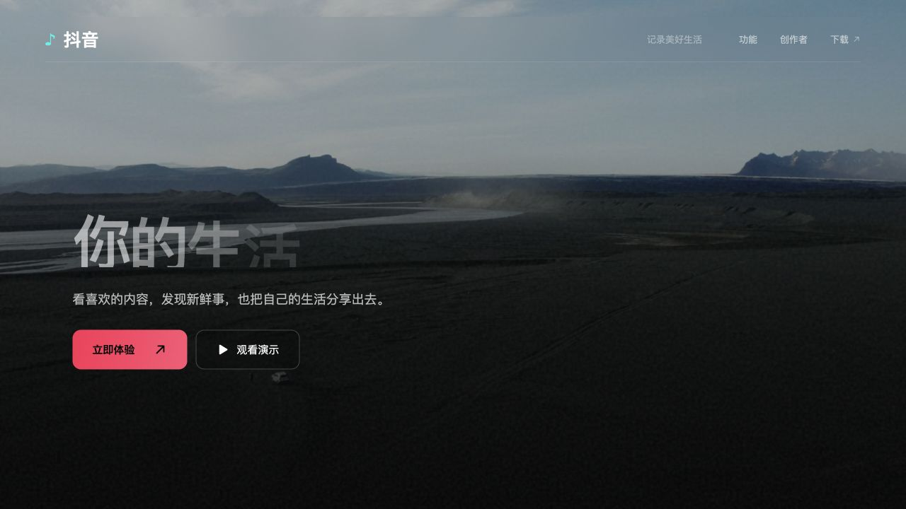

# 抖音精选 · 产品落地页

非官方抖音产品落地页演示，以暗夜霓虹视觉呈现视频内容、创作者与产品功能。仅用于学习、设计展示和交互实验，与抖音及字节跳动无隶属或背书关系。



## 功能

- 电影式首屏滚动转场与可交互手机演示
- 手风琴视频画廊与可拖动内容分类展示
- 创作者数据展示、功能矩阵、评论雨与下载入口
- 响应式布局与 `prefers-reduced-motion` 动效降级

## 本地运行

环境：Node.js 22.12+，pnpm 10。

```sh
pnpm install --frozen-lockfile
pnpm dev
```

打开终端显示的本地地址。

```sh
pnpm build
pnpm preview
```

## 技术栈

Vite、React、TypeScript、Tailwind CSS v4、GSAP / ScrollTrigger、React Bits、Lenis、OGL。

## 当前状态

这是交互原型，手机内的账号、作品及评论为演示内容，交互状态仅保存在当前页面。创作者与用户数据、备案号、下载二维码均包含占位内容；二维码不可扫描。部分官方入口待确认。正式使用前请核实数据、替换占位信息，并复核素材与品牌使用权限。部分视频通过外部 CDN 加载，播放依赖网络与来源可用性。

## 目录

- `src/components/`：页面板块与交互组件
- `src/components/react-bits/`：React Bits 组件及本项目适配
- `src/hooks/`：滚动与入场逻辑
- `src/data/videoLibrary.ts`：视频清单绑定
- `public/media/`：封面、背景视频与素材来源清单

## 开源与素材

原创项目代码采用 MIT 许可证，见 [LICENSE](LICENSE)。第三方库、组件、字体、照片、视频和品牌元素分别遵循其原有许可；MIT 不为这些资源重新授权。详见 [THIRD_PARTY_NOTICES.md](THIRD_PARTY_NOTICES.md)。
